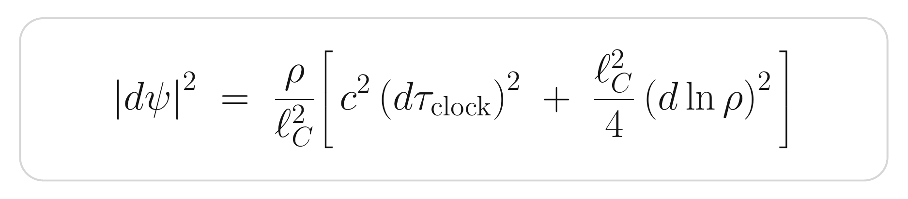
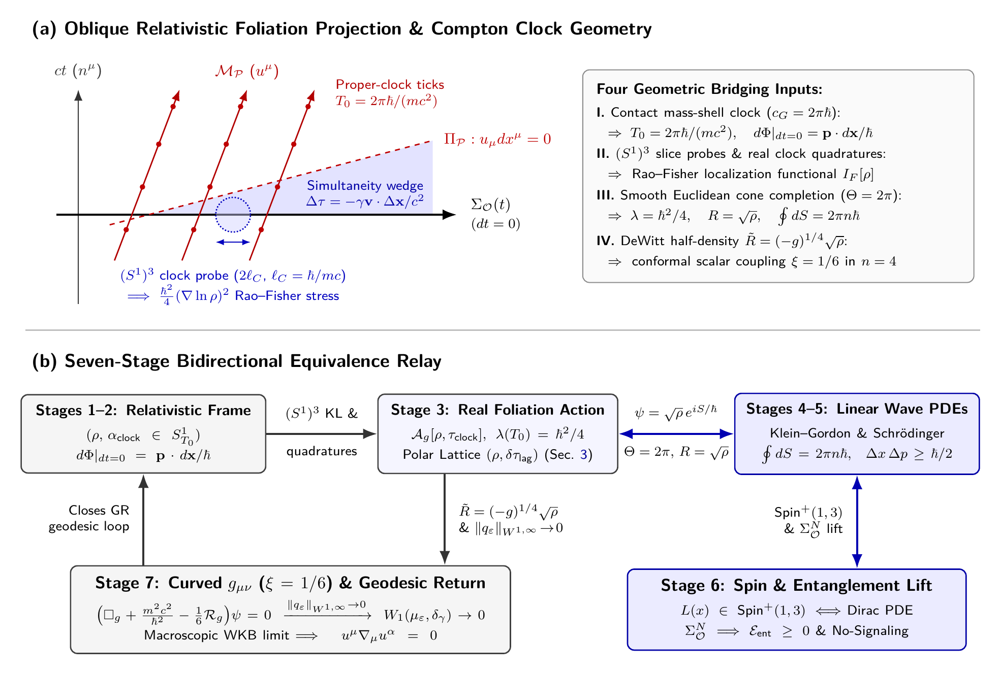
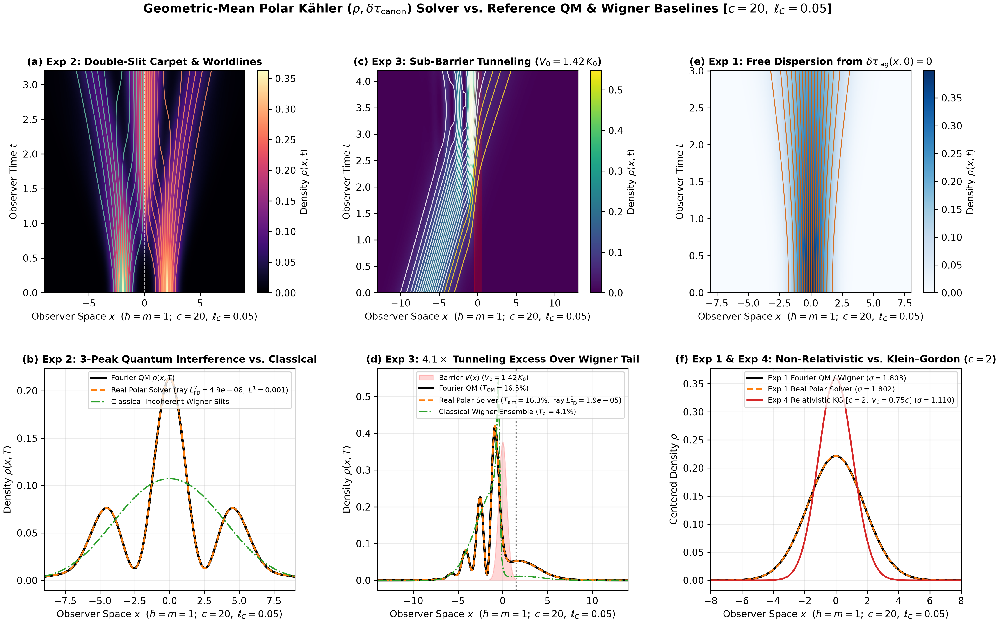

# The Quantum Mechanical Wave Function from Relativistic Foliation Incompatibility (`rfi-qm`)

**Tuomo Kiiskinen** · Stanford University (`tuomoki@stanford.edu`)

[**Paper PDF**](paper/deriving_the_quantum_mechanical_wave_function_from_relativistic_foliation_incompatibility_v18.pdf) · [**Lean 4 Formalization (`FoliationQM`)**](lean/) · [**Real-Variable Simulations**](simulations/) · [**Lean Audit Report**](lean/docs/CAMPAIGN_REPORT.md)

<p align="center">
  
</p>

---
## Intro

This work demonstrates equivalence between relativistic foliation incompatibility and quantum wave function. This, to my best knowledge, has not been mathematically established before. I started this project motivated by the longstanding incompatibility of theory of relativity and quantum mechanics already a couple of years ago. As "quantizing gravity" faces some notorious obstacles I was motivated by, for example, Sir Roger Penrose's idea of "geometrizing quantum". I was also led by a strong visual idea of riding beams of light on zero-interval (time and distance) null geodesics from a gravity well to another (general relativity curved spacetime), as an extreme example, and how this reduces basically to just instant piercings of a paper sheet like foliations through A to B. Studying first the geometry of these, the project evolved when I started to ponder if the pure information-theoretical nature of that setting could actually even yield exact solutions, or does it carry some fundamental intrinsic uncertainty. And from there I worked onwards from the leading idea being that could we show that these two things, relativistic foliation incompatibility (uncertainty) and quantum phenomena (uncertainty), are actually the same thing!

In the end, using substantial AI assistance for this work (mainly Gemini 4), I was able to find a clean chain one can use to walk from the relativistic side to the quantum side. The solution was basically in the end to combine two established traditions previously attempting a similar thing, which ended up being complementary missing pieces for each other: the tradition of relativistic internal clocks together with probability fluids and information theory/information-geometry approach. A cool thing is that this work also enabled a surprisingly impressive yet simple computational apparatus which allowed the simulation of quantum phenomena (like the double slit experiment) from relativistic inputs.

An important final remark is that I don't here claim that this is a pure "derivation" of QM from relativity: as the end goal of the equivalence was already known, four critical quantum world friendly conditions (specifically: compactifying the contact mass-shell Reeb fiber at Gromov capacity $`c_G = 2\pi\hbar`$, cross-slice Rao–Fisher localization at scale $`\ell_C = \hbar/(mc)`$, smooth $`\Theta = 2\pi`$ Euclidean cone completion with degree-one $`S^1_{T_0}`$ winding at nodal zeros, and DeWitt's curved-spacetime half-density ordering) enter the chain as explicit geometric inputs, from which the linear quantum equations are then proven. However, this does not negate how this equivalence demonstrates how the complex number QM identity is a mathematical necessity when we start from a pure real-number relativistic starting point! Also, while we provide a 150k LOC Lean formalization that compiles cleanly, I am of course fully aware that this only proves the internal mathematical machinery of this work, not any natural world physical implications, on which we take zero stances.

## Overview of the Main Contributions

Reconstructing Lorentzian spacetime from abstract Hilbert-space axioms is notoriously underconstrained: projective Hilbert space carries rich geometry, yet it specifies neither a causal structure nor a preferred spacetime foliation. This work bypasses those familiar obstructions by walking the problem in reverse—starting from **relativistic foliation-mismatch geometry** and proving an exact, bidirectional mathematical equivalence with linear complex wave mechanics across scalar, spinorial, multi-particle, and curved-spacetime regimes.

Over the past century, two geometric programs approached wave mechanics from opposite directions and stalled on each other's missing piece:

1. **Relativistic internal clocks (de Broglie, Greenberger):** Slicing obliquely across a moving congruence carrying a rapid proper clock ($`\omega_0 = mc^2/\hbar`$) turns Einstein's relativity of simultaneity into the de Broglie phase gradient $`\mathbf{p}\cdot d\mathbf{x}/\hbar`$—surviving $`c \to \infty`$ via exact $`c^2 \times c^{-2}`$ cancellation. Yet moving clocks alone behave like classical dust and do not explain dispersion, tunneling, or the Born rule $`|\psi|^2`$.
2. **Probability fluids and information geometry (Madelung, Bohm, Reginatto, Hall, Khesin–Modin):** Penalizing a real density by Rao–Fisher information linearizes Hamilton–Jacobi dynamics into wave mechanics, yet left open why quantum ensembles feel the exact coupling $`\lambda = \hbar^2/4`$ while classical ensembles do not, and how to resolve Wallstrom's vortex-quantization objection without imposing integer circulation by hand.

Unifying both programs shows that four geometric inputs close the equivalence simultaneously: a **compactified contact mass-shell clock** of Compton period $`T_0 = 2\pi\hbar/(mc^2)`$ ($`\ell_C = \hbar/(mc)`$), **cross-slice Rao–Fisher localization**, **smooth Euclidean cone completion** ($`\Theta = 2\pi`$) at zero-density nodes—which uniquely locks $`\lambda = \hbar^2/4`$ and the Born rule $`R = \sqrt{\rho}`$ while single-valuedness on $`S^1_{T_0}`$ enforces quantized Sagnac–Wallstrom vortices—and **DeWitt's curved-spacetime half-density ordering** yielding conformal coupling $`\xi = 1/6`$.

> **Scope:** The results establish a strict bidirectional mathematical equivalence on their stated domains, separating deductive geometry from causal or ontological interpretation. Every theorem can be traversed from real relativistic foliation variables $`(\rho, \tau_{\mathrm{clock}})`$ to linear wave mechanics $`\psi`$, and back.

---

## The Three RFI–QM Master Equations

Projecting a timelike congruence $`\mathcal{M}_{\mathcal{P}}`$ of rest mass $`m > 0`$ carrying a periodic proper clock $`\tau_{\mathrm{clock}} \in S^1_{T_0} = \mathbb{R}/T_0\mathbb{Z}`$ onto an observer's spatial foliation $`\mathcal{M}_{\mathcal{O}}`$ compresses the equivalence into three core relations (Section 2.1; detailed proofs in Sections 4–10):

### I. Local Kähler–Clock Metric Identity

On $`\rho(x) > 0`$, pairing the real spatial modulus density $`\rho(x)`$ with the closed phase-clock synchronization 1-form $`\alpha_{\mathrm{clock}} \equiv d\tau_{\mathrm{clock}} = -dS/(mc^2)`$ satisfies the exact unweighted Euclidean target-space metric identity for $`\psi(x) \equiv \sqrt{\rho(x)}\exp\!\left(-i\frac{2\pi}{T_0}\tau_{\mathrm{clock}}(x)\right)`$:

```math
|d\psi|^2 \;\equiv\; \frac{(d\rho)^2}{4\rho} + \rho\,(d\Phi)^2 \;\equiv\; \frac{\rho}{\ell_C^2}\left[\, c^2\left(d\tau_{\mathrm{clock}}\right)^2 + \left(\frac{c T_0}{4\pi}\right)^2 (d\ln\rho)^2 \,\right], \qquad \Phi(x) \equiv -\frac{2\pi}{T_0}\tau_{\mathrm{clock}}(x).
```

Away from $`\rho = 0`$, any Fisher weight $`\lambda > 0`$ is locally flat; at nodal zeros $`\rho = 0`$, the target metric on $`\mathbb{R}^+ \times S^1_{T_0}`$ forms a cone of opening angle $`\Theta(\lambda) = \pi\hbar/\sqrt{\lambda}`$. Requiring smooth Euclidean cone completion ($`\Theta = 2\pi`$) with unit clock winding uniquely selects **$`\lambda = \hbar^2/4`$** and the **Born amplitude $`R = \sqrt{\rho}`$** (Lemma 6.3).

### II. Global Variational Master Equivalence

Pulling back the Kähler–Clock metric to a curved four-dimensional Lorentzian manifold $`(\mathcal{M}, g_{\mu\nu})`$ with Ricci scalar $`\mathcal{R}_g(x)`$ and DeWitt symmetric half-density volume curvature $`\frac{\ell_C^2}{6}\mathcal{R}_g(x)`$ yields the exact action equivalence:

```math
\begin{aligned}
\frac{\mathcal{A}_g[\rho, \tau_{\mathrm{clock}}]}{m^2 c^2} &\equiv \int_{\mathcal{M}} d^4x\sqrt{-g}\;\rho(x)\left[\, c^2 g^{\mu\nu}(\nabla_\mu \tau_{\mathrm{clock}})(\nabla_\nu \tau_{\mathrm{clock}}) - 1 + \frac{\ell_C^2}{4} g^{\mu\nu}(\nabla_\mu \ln\rho)(\nabla_\nu \ln\rho) + \frac{\ell_C^2}{6}\mathcal{R}_g(x) \,\right] \\
&\equiv \int_{\mathcal{M}} d^4x\sqrt{-g}\;\psi^{\ast}(x)\left( -\ell_C^2 \Box_g - 1 + \frac{\ell_C^2}{6}\mathcal{R}_g(x) \right)\psi(x) \;\equiv\; \frac{\mathcal{A}_g[\psi, \psi^{\ast}]}{m^2 c^2}.
\end{aligned}
```

### III. Dressed Relativistic Mass-Energy Relation

Stationary variation with respect to $`\rho(x)`$ generalizes $`E_0 = mc^2`$ on the timelike phase domain $`\mathcal{U}_{\mathrm{timelike}}`$ via the Fisher-dressed effective mass $`M_{\mathrm{eff}}(x)`$ and unit-normalized 4-velocity $`U_\mu(x)`$ ($`g^{\mu\nu}U_\mu U_\nu = c^2`$):

```math
M_{\mathrm{eff}}(x)^2 c^4 \;=\; (mc^2)^2 \left( 1 + \ell_C^2 \frac{\Box_g \sqrt{\rho(x)}}{\sqrt{\rho(x)}} - \frac{\ell_C^2}{6}\mathcal{R}_g(x) \right), \qquad U_\mu(x) \equiv \frac{m c^2}{M_{\mathrm{eff}}(x)}\nabla_\mu \tau_{\mathrm{clock}}(x).
```

Reading these three equations **left to right** ($`\Delta x \sim \ell_C`$) yields linear Klein–Gordon, Schrödinger, and Dirac wave mechanics, quantized nodal vortices, Heisenberg uncertainty, and multi-particle entanglement; reading them **right to left** ($`\|q_\varepsilon\|_{W^{1,\infty}} \to 0`$) concentrates the current-flux probability measure quantitatively in 1-Wasserstein distance back onto **classical Einstein geodesics** $`u^\mu\nabla_\mu u^\alpha = 0`$.

---

## Seven-Stage Equivalence Chain (`v18` Map)

<p align="center">
  
</p>

*Figure 1: **(a)** Oblique relativistic foliation projection and Compton clock geometry; **(b)** seven-stage bidirectional equivalence relay from real cross-foliation variables $`(\rho, \tau_{\mathrm{clock}})`$ to linear scalar and spinorial quantum mechanics and back to classical Einstein geodesics in the macroscopic WKB limit.*

| Stage | Topic | Section (`v18`) | Core Statements | Geometric Mechanism |
|---:|---|---|---|---|
| **1** | Foliation Tilt & Simultaneity 1-Form | Sec. 4 | Lemma 4.1, Remark 4.2 | Oblique projection $`\beta_{\mathrm{proper}}\vert_{dt=0} = -\gamma\mathbf{v}\cdot d\mathbf{x}/c^2`$ |
| **2** | Contact Mass-Shell Clock | Sec. 5 | Thm. 5.1, Prop. 5.2 | Reeb flow on $`\mathcal{H}_m`$, Gromov capacity $`c_G = 2\pi\hbar`$, $`c^2 \times c^{-2}`$ cancellation |
| **3** | Cross-Slice Rao–Fisher Stress | Sec. 6 | Thm. 6.1, Remark 6.2 | $`(S^1)^3`$ Compton clock probes & phase-averaged real clock quadratures ($`\lambda = \hbar^2/4`$) |
| **4** | Cone Completion, Born Rule & Wave PDEs | Sec. 6.1 | Lemma 6.3, Thm. 6.5, Cor. 6.6 | Smooth cone completion ($`\Theta = 2\pi \Rightarrow R = \sqrt{\rho}`$) linearizing into KG & Schrödinger PDEs |
| **5** | Quantized Vortices, ADM Mass & Uncertainty | Sec. 6.2–7 | Thm. 6.7, Thm. 6.8, Thm. 7.1 | $`S^1_{T_0}`$ holonomy ($`\oint dS = 2\pi n\hbar`$), codimension-2 PDE removability, Cramér–Rao $`\Delta x\,\Delta p \ge \hbar/2`$ |
| **6** | Dirac Spinors & $`N`$-Body Entanglement | Sec. 8–9 | Prop. 8.1, Thm. 8.3, Prop. 9.1, Thm. 9.2 | $`\mathrm{Spin}^+(1,3) \cong SL(2,\mathbb{C})`$ rotor lift to Dirac PDE; conditional Fisher excess $`\mathcal{E}_{\mathrm{ent}} \ge 0`$ & exact no-signaling |
| **7** | Curved Spacetime ($`\xi = 1/6`$) & Geodesic Return | Sec. 10 | Thm. 10.2, Prop. 10.4, Thm. 10.5, Conj. 10.7 | DeWitt half-density $`(-g)^{1/4}\sqrt{\rho}`$, $`W_1(\mu_\varepsilon, \delta_\gamma) \to 0`$, and candidate $`O(\ell_C^2 E_{\mu\nu})`$ tidal conjecture |

---

## Purely Real-Variable Numerical Benchmarks

Because the equivalence is constructive from end to end, we test it directly in Section 3 by discarding complex arithmetic altogether and evolving purely real spatial amplitude and clock-lag fields $`(R, \delta\tau_{\mathrm{lag}})`$ on $`\mathbb{R}^+ \times S^1_{T_0}`$. Replacing the traditional arithmetic link average $`\frac{1}{2}(\rho_{j+1}+\rho_j)`$ with the **geometric-mean Kähler link $`R_{j+1}R_j`$** removes the $`O((\Delta R)^2[1 - \cos\Delta\phi])`$ lattice defect responsible for hydrodynamic node stiffness—reproducing interference and tunneling with **zero artificial viscosity**.

<p align="center">
  
</p>

| Benchmark ($`\hbar = m = 1`$; $`c = 20, \ell_C = 0.05`$ in Exps. 1–3) | Classical Wigner Baseline (same $`\rho_0`$) | Real Polar $`(R, \delta\tau_{\mathrm{lag}})`$ Solver | Fourier QM | Same-Lattice Accuracy & Key Signature |
|---|---|---|---|---|
| **1. Free Dispersion** $`\sigma(T = 3.0)`$ from $`v_{\mathrm{rel}}(x,0)=0`$ | $`1.799947`$ (cold dust: $`1.000`$) | **$`1.802240`$** | $`1.802776`$ | ray $`L^2_{\mathrm{FD}} = 5.44 \times 10^{-10}`$, $`L^1 = 2.0 \times 10^{-4}`$ |
| **2. Young Double-Slit** $`\rho(0, T = 3.2)`$ | $`0.1073`$ (1 hump, **0 fringes**) | **$`0.2130`$** (3 peaks) | $`0.2129`$ (3 peaks) | ray $`L^2_{\mathrm{FD}} = 4.90 \times 10^{-8}`$, $`L^1 = 9.0 \times 10^{-4}`$ |
| **3. Sub-Barrier Tunneling** $`P(x > 1.5, T = 4.2)`$ | $`4.05\%`$ (cold ray: $`0.00\%`$) | **$`16.35\%`$** (nodes: $`4+/0-`$) | $`16.48\%`$ (nodes: $`4+/0-`$) | ray $`L^2_{\mathrm{FD}} = 1.87 \times 10^{-5}`$; $`T=9`$: **$`30.3\%`$ vs. $`6.5\%`$** ($`4.7\times`$) |
| **4. Boosted Klein–Gordon** $`\sigma_{\vert\psi\vert^2}(T = 3.0)`$ | — | $`c=2\;(v_0=0.75c)`$: **$`1.1097`$** | $`c=20`$: $`1.7912`$ | Genuine finite-$`c`$ longitudinal $`\gamma^{-3}`$ Lorentz suppression |

Discrete norm conservation holds to $`\le 5.22 \times 10^{-15}`$ across Experiments 1–3 ($`3.18 \times 10^{-12}`$ at $`T = 9.0`$) and discrete energy to $`\le 7.60 \times 10^{-9}`$.

---

## Machine-Checked Formalization in Lean 4 (`FoliationQM`)

All core analytical theorems of Sections 2 and 4–10—together with the discrete polar Kähler lattice identities of Section 3.1—are formally verified in **Lean 4** (`Lean 4.35.0` pinned against `Mathlib v4.35.0`):

- **Scale & Completeness:** `1,167` Lean modules (~`153,000` LOC), `9,602` handwritten public theorems, `20,773` kernel-audited declarations, and all `69` core manuscript proof targets verified with **0 proof holes** (`sorry`-free).
- **Zero Custom Axioms:** Every declaration depends exclusively on the three standard Mathlib axioms (`propext`, `Classical.choice`, `Quot.sound`).
- **Transparent External Hypotheses:** Three standard geometric/PDE literature theorems are passed explicitly as theorem hypotheses rather than declared as axioms:
  1. Gromov's symplectic non-squeezing theorem (Theorem 5.1(ii));
  2. Local chart comparability of general smooth Riemannian distance functions (Section 6.2 cutoff bounds);
  3. Global smooth and finite-energy Cauchy well-posedness on globally hyperbolic manifolds (continuation step of Theorem 6.7(c)).
- Conjecture 10.7 is formalized as a conditional theorem deriving its exact Euler–Lagrange equation from its stated proper-time variance ansatz.

---

## Repository Layout

| Directory | Contents |
|---|---|
| [`paper/`](paper/) | Manuscript LaTeX source (`v18`), compiled PDF, vector figure `showcase_v9.pdf`, and Figure 1 overview PNG. |
| [`lean/`](lean/) | Machine-checked Lean 4 formalization (`FoliationQM`, `Lean 4.35.0` / `Mathlib v4.35.0`) and audit scripts. |
| [`simulations/`](simulations/) | Purely real-variable polar Kähler lattice and relativistic Klein–Gordon benchmarks reproducing Table 2 and Figure 2. |

## Reproducing the Lean 4 Formalization

```bash
cd lean
lake exe cache get
lake build
lake env lean scripts/AxiomAudit.lean
python3 scripts/check_lean.py
```

See [`lean/docs/CAMPAIGN_REPORT.md`](lean/docs/CAMPAIGN_REPORT.md) for the complete target-by-target audit (note: section and theorem leading digits in the v13 campaign report shift by `+1` in the `v18` flat-numbered manuscript, e.g., `Lemma 5.3` → `Lemma 6.3`, `Theorem 5.7` → `Theorem 6.7`, `Conjecture 9.7` → `Conjecture 10.7`).

## Reproducing the Numerical Benchmarks

```bash
cd simulations
pip install -r requirements.txt
python3 simulate_foliation_qm_v10.py
```

Outputs regenerate `showcase_v9.(pdf|png|svg)` and `table2_v10_regenerated.md`.

## Citation

```bibtex
@misc{kiiskinen2026foliationqm,
  author       = {Tuomo Kiiskinen},
  title        = {The Quantum Mechanical Wave Function from Relativistic Foliation Incompatibility},
  year         = {2026},
  howpublished = {Stanford University; companion Lean 4 formalization \texttt{FoliationQM}},
  url          = {https://github.com/yuj1r0/rfi-qm},
  note         = {v18}
}
```
